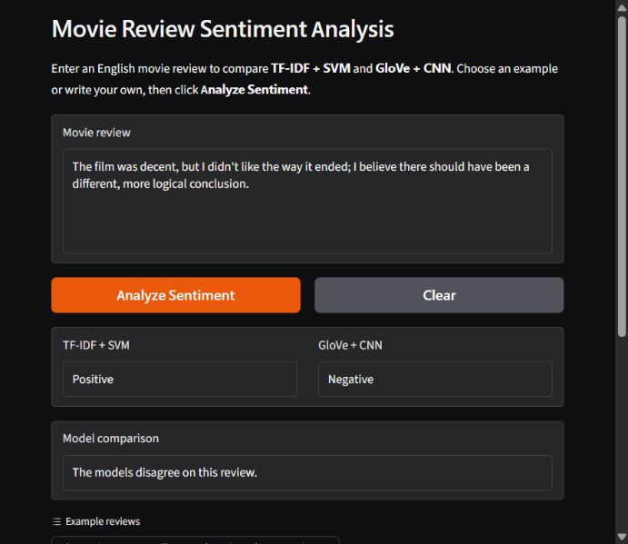

# IMDb Sentiment Analysis: SVM vs CNN

An English movie-review sentiment classifier with a local Gradio interface. Compare **TF-IDF + Linear SVM** with **GloVe + CNN** on the same review.



## Run locally in VS Code

Use **Python 3.12** and open this folder in VS Code. In its PowerShell terminal:

```powershell
python -m venv .venv
.\.venv\Scripts\python.exe -m pip install -r requirements.txt
.\.venv\Scripts\python.exe setup_resources.py
.\.venv\Scripts\python.exe app.py --check-models
.\.venv\Scripts\python.exe app.py
```

For the already configured laptop, only the last command is needed. Open the local URL printed in the terminal, normally http://127.0.0.1:7860. Stop the server with **Ctrl+C**. A GPU is not required.

Enter an English movie review and click **Analyze Sentiment**. The interface displays both predictions and whether they agree. Examples, a Clear button, and the recorded test results are included.

The trained files in `models/` are required. The dataset and original GloVe text file are unnecessary for the interface. NLTK resources are downloaded once during setup, not during predictions.

## Project files

| File | Purpose |
| --- | --- |
| `app.py` | Starts the local interface |
| `kaggle_interface.py` | Gradio layout and input validation |
| `preprocessing.py` | Cleaning, negation handling, tokenization, and lemmatization |
| `inference.py` | Loads models once and predicts sentiment |
| `keras_numpy.py` | Runs the exported CNN weights on the CPU |
| `models/` | Trained models, runtime metadata, and reference predictions |
| `imdb-sentiment-analysis-executed.ipynb` | Executed Kaggle training and evaluation notebook |
| `kaggle_export_cell.py` | Export cell for future Kaggle training runs |
| `setup_resources.py` | Downloads WordNet and the English POS tagger |
| `requirements.txt` | Tested local dependencies |
| `tests/` | Preprocessing and interface checks |
| `output/` | Interface screenshot and model verification evidence |

## How a prediction works

1. `app.py` connects the interface to one `SentimentPredictor`.
2. The review is cleaned: remove HTML, lowercase, expand negative contractions, tokenize, and lemmatize using part-of-speech tags. Negation words such as **not** are preserved.
3. The saved TF-IDF vectorizer transforms text using its training vocabulary and IDF weights. The SVM predicts **Negative** or **Positive**.
4. The CNN uses its saved vocabulary to create 450 token IDs, padding or truncating when needed. Frozen 100-dimensional GloVe embeddings feed a convolution, global max pooling, and dense layers. A sigmoid score of at least 0.5 gives **Positive**.
5. The interface displays both labels. Disagreement is possible, especially with mixed opinions.

Training took place in Kaggle using TensorFlow/Keras. Local predictions do not retrain models or update vocabularies. The SVM decision score is not a probability.

### Lightweight CNN runtime

The default backend reads the original `.keras` archive's vocabulary and weights with h5py and executes this particular CNN's forward pass with NumPy. It uses the trained weights unchanged, supports only this project's architecture, and does not call the Keras runtime. This keeps local setup smaller.

An optional TensorFlow/Keras backend is available:

```powershell
.\.venv\Scripts\python.exe -m pip install -r models\requirements-inference.txt
.\.venv\Scripts\python.exe app.py --backend tensorflow
```

The tested default is the NumPy CPU backend on Python 3.12. Model runtime versions are recorded in `models/training_metadata.json`.

## Training and evaluation

The IMDb dataset originally contains 50,000 balanced reviews. Removing duplicates, including those revealed by cleaning, leaves 49,578 reviews. A stratified split with seed 42 uses 39,662 training, 4,958 validation, and 4,958 test reviews. Vocabularies are fitted on training data only; validation selects the CNN checkpoint.

| Model | Test accuracy | Macro precision | Macro recall | Macro F1 | ROC-AUC |
| --- | ---: | ---: | ---: | ---: | ---: |
| TF-IDF + SVM | 0.9086 | 0.9089 | 0.9086 | 0.9086 | 0.9682 |
| GloVe + CNN | 0.8711 | 0.8711 | 0.8711 | 0.8711 | 0.9426 |

SVM performs better for these configurations. CNN uses a smaller vocabulary, frozen embeddings, and a 450-token input limit. These differences are limitations of the comparison, not individually proven causes of the performance gap.

The transferred models reproduced all four saved Kaggle reference predictions and the metrics on all 4,958 saved test reviews to four decimal places. This confirms model transfer; it is not a new independent test. Exact metrics, confusion matrices, and model hashes are in `output/model_verification.json`.

Run the quick checks:

```powershell
.\.venv\Scripts\python.exe -m unittest discover -s tests -v
.\.venv\Scripts\python.exe app.py --check-models
```

## Retraining on Kaggle

Use the executed notebook as the training reference, attach the IMDb CSV and GloVe 6B 100d resources, and adjust its Kaggle input paths to match your attached datasets. Train on Kaggle, not on the local demo laptop. Run `kaggle_export_cell.py` as a final notebook cell and download its model ZIP. Extract the bundle directly into `models/`, then run `app.py --check-models` locally.

## GitHub contents

Source code, the executed notebook, trained models, and verification evidence belong in the repository. `.gitignore` excludes the virtual environment, downloaded NLTK resources, caches, credentials, and temporary slide-building files. Local recovery backups are stored outside this project folder.

After cloning, follow the setup commands above to recreate the environment and linguistic resources.

## Presentation

The English presentation and matching script are in `output/presentation/`:

- `IMDb_Sentiment_Analysis.pptx`: editable PowerPoint with an English script and per-slide timings in speaker notes.
- `IMDb_Sentiment_Analysis.pdf`: matching slides for viewing or sharing.
- `Presentation_Script.md`: the approved speaking script with the four accuracy clarifications, matching the slide order.

Rehearse slides 1-14 for eight minutes, including the cover, outline, demonstration, and final thank-you slide. The PowerPoint also contains three hidden appendix slides with metric definitions, experimental controls, and references for questions. The PDF contains the 14 main slides and ends with the thank-you page. Conceptual illustration assets and generation prompts are in `output/presentation/assets/`.
